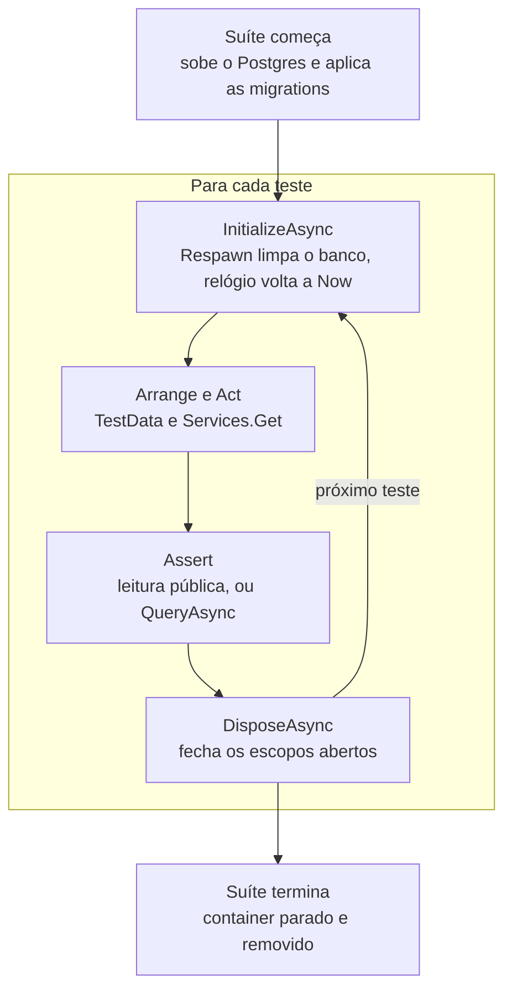

# Ecommerce.IntegrationTests

Testes dos services contra um PostgreSQL real, com a mesma composição de DI de produção. O porquê está na [ADR 0021](../docs/adr/0021-estrategia-de-testes.md); as regras de escrita, no [Conventions.md](../docs/Conventions.md#testes).

Para rodar, o Docker precisa estar ativo: `dotnet test Ecommerce.IntegrationTests`.

## As peças

| Peça | Problema que resolve |
|---|---|
| `DatabaseFixture` | Subir o Postgres (Testcontainers), montar o DI e aplicar as migrations é caro: acontece uma vez por suíte. |
| `DatabaseCollection` | Compartilha a fixture entre as classes e faz os testes rodarem um de cada vez, já que o banco é único. |
| `Respawner` | Apaga as linhas de todas as tabelas sem recriar o schema. |
| `TestTimeProvider` | Único `TimeProvider` registrado; por trás dele, cada teste ganha um `FakeTimeProvider` novo. |
| `TestCurrentUserProvider` | Substitui o usuário do JWT: o teste define quem está chamando. |
| `IntegrationTestBase` | Liga a classe à collection, reseta banco e relógio e expõe `Services`, `TestData`, `Time` e `QueryAsync`. |
| `ServiceResolver` | Imita uma requisição: um escopo novo por chamada, como o usuário escolhido. |
| `TestData` | Monta cenários pelos services públicos, com valores padrão válidos. |

## Ciclo de vida



O reset vem antes do teste, e não depois: se um teste falhar, os dados dele ficam no banco para inspeção.

## Exemplo

```csharp
public class ProductServiceTests(DatabaseFixture fixture) : IntegrationTestBase(fixture)
{
    [Fact]
    public async Task Create_PersistsProductForCurrentSeller()
    {
        var seller = await TestData.SellerAsync();

        var created = await TestData.ProductAsync(seller, stockBalance: 5);

        var product = await Services.Get<ProductService>().GetByIdAsync(created.Id);
        Assert.Equal(5, product.StockBalance);
    }
}
```

`Services.Get<T>()` resolve um service anônimo; `Services.Get<T>(seller)` ou `Services.Get<T>(customer)`, como aquele usuário.

## Armadilhas

- **O relógio não volta:** o `FakeTimeProvider` recusa voltar no tempo, por isso a troca a cada teste fica no `TestTimeProvider`. Não registre um `FakeTimeProvider` direto.
- **Escopos vivem até o fim do teste:** o service usa o `DbContext` do escopo; descartá-lo antes quebra o service.
- **Toda classe de teste herda `IntegrationTestBase`:** é ela que coloca a classe na collection e faz o reset.
